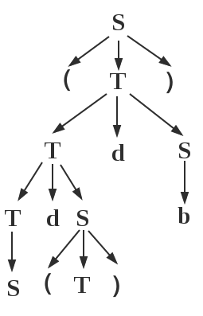
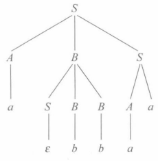
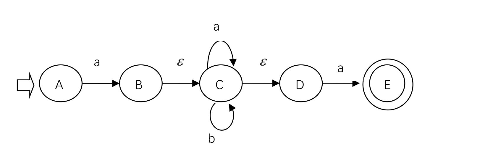
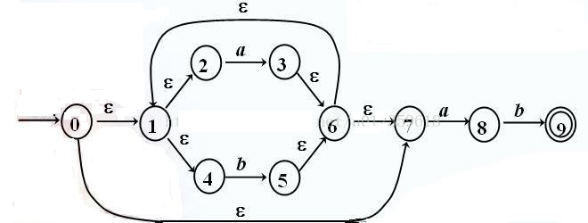
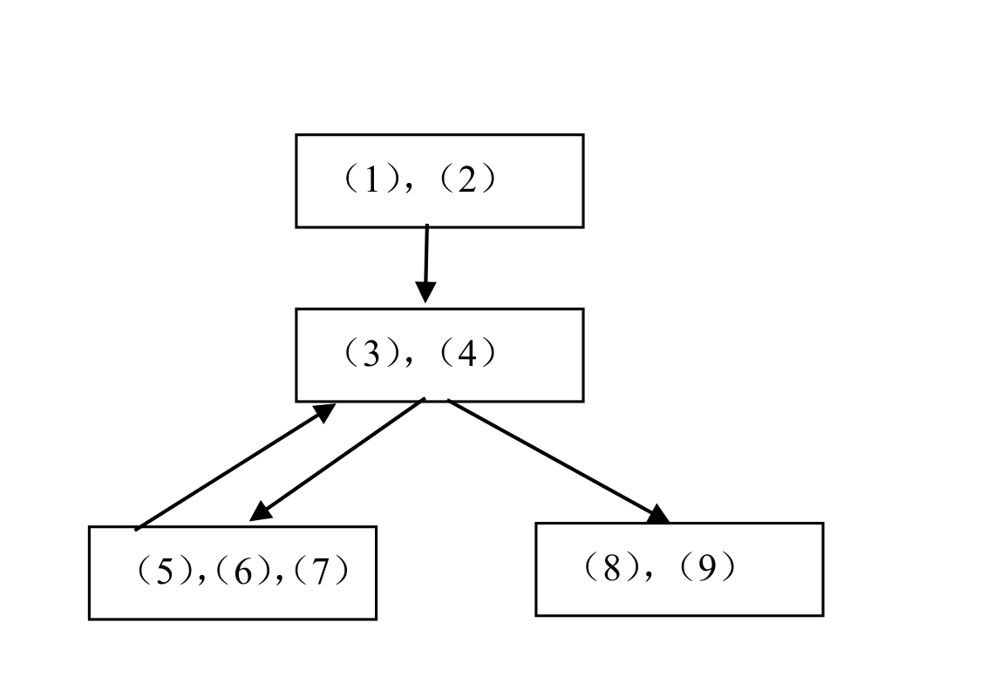
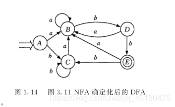
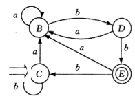
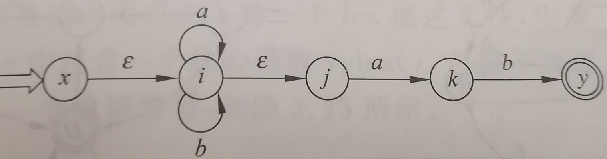
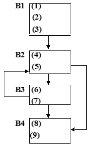
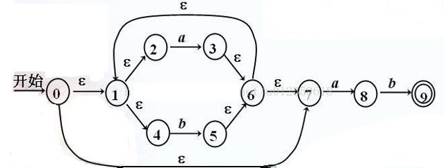

# 编译原理复习题与参考答案

> 本文件由目录中的 4 套《编译原理》复习题及参考答案整理而成。为便于阅读，已统一符号（`→`、`ε`、`×` 等），补全转换过程中丢失的箭头，并把部分手写答案转写为文字、表格；原始插图保存在 `images/` 目录。
>
> 目录对应关系：
>
> | 套数 | 题目 | 参考答案 |
> | --- | --- | --- |
> | 第一套 | `1.doc` | `1答案.pdf` |
> | 第二套 | `2.doc` | `2答案(1).docx` |
> | 第三套 | `3(1).doc` | `3答案(1).doc` |
> | 第四套 | `4.doc` | `4答案.doc` |

## 目录

- [第一套](#第一套)：基础题、算法设计题、LL(1) 预测分析
- [第二套](#第二套)：基础题、简单优先 / NFA / LL(1)
- [第三套](#第三套)：基础题、正规式 / DFA / LL(1)
- [第四套](#第四套)：基础题、正规文法 / LL(1) / LR(0)

---

## 第一套

> 对应资料：`1.doc`（题目）、`1答案.pdf`（参考答案）。

### 一、基础题

#### 1. 证明文法 `G[E]` 是二义的

**题目：** 已知文法

```text
G[E]: E → E+E | E*E | (E) | i
```

证明该文法是二义的。

**答案：** 取句子 `i+i*i`，它存在两棵不同的语法树：

```text
        E                         E
      / | \                     / | \
     E  +  E                   E  *  E
     |    /|\                 /|\   |
     i   E * E               E + E  i
         |   |               |   |
         i   i               i   i
```

第一棵语法树先做加法，第二棵语法树先做乘法，两棵语法树不同，因此句子 `i+i*i` 有两棵不同的语法树，文法 `G[E]` 是二义的。

#### 2. 计算句型的直接短语和句柄

**题目：** 某句型的语法树如下图所示，计算该句型的直接短语和句柄。



**答案：**

- 直接短语：`S`、`(T)`、`b`
- 句柄：`S`

#### 3. 判断两个文法是否等价

**题目：** 判断文法

```text
G[S]: S → 0S1 | 01
G[A]: A → 0R | 01
      R → A1
```

是否等价。

**答案：** 两个文法生成的语言分别为

```text
L(G[S]) = { 0^n 1^n | n ≥ 1 }
L(G[A]) = { 0^m 1^m | m ≥ 1 }
```

二者语言相同，所以 `G[S]` 与 `G[A]` 等价。

#### 4. 划分基本块并画程序流图

**题目：** 根据以下中间代码段划分基本块，使得每个基本块只有一个入口和一个出口，并画出基本块间的程序流图。

```text
(1) read X
(2) read Y
(3) R = X mod Y
(4) if R = 0 goto (8)
(5) X = Y
(6) Y = R
(7) goto (3)
(8) write Y
(9) halt
```

**答案：** 基本块划分为：

| 基本块 | 语句 |
| --- | --- |
| B1 | (1)、(2) |
| B2 | (3)、(4) |
| B3 | (5)、(6)、(7) |
| B4 | (8)、(9) |

程序流图：

```text
B1 ──→ B2 ──R=0──→ B4
         │
       R≠0
         ↓
        B3 ──→ B2
```

其中 `B4` 执行完程序结束。

#### 5. 写逆波兰式

**题目：** 用逆波兰式表达中缀式 `a*(b+c)-d/e`。

**答案：**

```text
abc+*de/-
```

#### 6. 计算简单优先关系

**题目：** 已知文法

```text
G[S]: S → a | d | (T)
      T → T b S | S
```

计算该文法所包含的所有符号（包括终结符和非终结符，`#` 无需计算）之间可能包含的优先关系。

**答案：**

| 关系 | 符号对 |
| --- | --- |
| `=` | `(=T`，`T=)`，`T=b`，`b=S` |
| `<` | `(<T`，`(<S`，`(<a`，`(<d`，`(<(`，`b<a`，`b<d`，`b<(` |
| `>` | `S>)`，`a>)`，`d>)`，`)>)`，`S>b`，`a>b`，`d>b`，`)>b` |

### 二、算法设计题

#### 1. 构造 NFA

**题目：** 构造与正规式 `b(a|b)*aa` 等价的 NFA。

**答案：** 设初态为 0，终态为 3，状态转移如下：

| 状态 | a | b |
| --- | --- | --- |
| 0 | — | {1} |
| 1 | {1, 2} | {1} |
| 2 | {3} | — |
| 3 | — | — |

即：

```text
0 ──b──→ 1 ──a──→ 2 ──a──→ 3
          ↑
        a,b（自环）
```

#### 2. DFA 化简

**题目：** 对下图所示 DFA 进行化简，并画出合并等价状态后的 DFA。


**答案：** 原 DFA 的状态转移如下：

| 状态 | a | b |
| --- | --- | --- |
| A（初态） | B | C |
| B | B | D |
| C | B | C |
| D | B | E |
| E（终态） | B | C |

利用分割法：

```text
(1) {A, B, C, D} {E}
(2) {A, B, C} {D} {E}
(3) {A, C} {B} {D} {E}
```

因此 `A` 与 `C` 等价，可以合并为一个状态。设合并后的状态为 `S`，则最小化 DFA 为：

| 状态 | a | b |
| --- | --- | --- |
| S（初态，原 A、C） | B | S |
| B | B | D |
| D | B | E |
| E（终态） | B | S |

#### 3. 消除左递归

**题目：** 若某文法形如

```text
A → Aα1 | Aα2 | … | Aαm | β1 | β2 | … | βn
```

消除该文法中所含的左递归。

**答案：** 引入新非终结符 `A′`，将产生式改写为：

```text
A  → β1A′ | β2A′ | … | βnA′
A′ → α1A′ | α2A′ | … | αmA′ | ε
```

#### 4. 提取左公因子

**题目：** 已知文法

```text
G[E]: E → bAb | bBc | f
      A → a
      B → b
```

按参考答案提取左公因子，使其成为 LL(1) 文法。

**答案：** 提取公共前缀 `b`：

```text
E  → bE′ | f
E′ → Ab | Bc
A  → a
B  → b
```

### 三、LL(1) 预测分析

**题目：** 已知文法

```text
G[S]: S → aH
      H → aMd | d
      M → Ab | ε
      A → aM | e
```

1. 构造该文法的预测分析表（需对每条产生式计算 `select` 函数，本小题 10 分）。
2. 分析 `aaabd#` 是否是文法的句子（写出含有分析栈、剩余输入串的分析过程，本小题 16 分）。

**答案：**

各产生式的 `select` 集为：

```text
select(S → aH)   = {a}
select(H → aMd)  = {a}
select(H → d)    = {d}
select(M → Ab)   = FIRST(Ab) = {a, e}
select(M → ε)    = FOLLOW(M) = {b, d}
select(A → aM)   = {a}
select(A → e)    = {e}
```

预测分析表：

| 非终结符 | a | d | b | e | # |
| --- | --- | --- | --- | --- | --- |
| S | S→aH |  |  |  |  |
| H | H→aMd | H→d |  |  |  |
| M | M→Ab | M→ε | M→ε | M→Ab |  |
| A | A→aM |  |  | A→e |  |

对句子 `aaabd#` 的分析过程：

| 步骤 | 分析栈 | 剩余输入串 |
| --- | --- | --- |
| 1 | `#S` | `aaabd#` |
| 2 | `#Ha` | `aaabd#` |
| 3 | `#H` | `aabd#` |
| 4 | `#dMa` | `aabd#` |
| 5 | `#dM` | `abd#` |
| 6 | `#dbA` | `abd#` |
| 7 | `#dbMa` | `abd#` |
| 8 | `#dbM` | `bd#` |
| 9 | `#db` | `bd#` |
| 10 | `#d` | `d#` |
| 11 | `#` | `#` |

最后分析栈与输入串均为 `#`，分析成功，所以 `aaabd#` 是该文法的句子。

---

## 第二套

> 对应资料：`2.doc`（题目）、`2答案(1).docx`（参考答案）。

### 一、基础题

#### 1. 写逆波兰式

**题目：** 写出表达式 `a*b+c` 的逆波兰式形式。（2 分）

**答案：**

```text
ab*c+
```

#### 2. 计算符号串的头和尾

**题目：** 计算符号串 `abc` 的头和尾。（8 分）

**答案：**

```text
头：ε，a，ab，abc
尾：ε，c，bc，abc
```

#### 3. 最左推导、最右推导及语法树

**题目：** 已知文法

```text
G[E]: E → T | E+T
      T → F | T*F
      F → (E) | a
```

1. 给出表达式 `a+a*a` 的最左推导。（10 分）
2. 给出表达式 `a*a` 的最右推导及语法树。（10 分）

**答案：**

（1）`a+a*a` 的最左推导：

```text
E ⇒ E+T ⇒ T+T ⇒ F+T ⇒ a+T
  ⇒ a+T*F ⇒ a+F*F ⇒ a+a*F ⇒ a+a*a
```

（2）`a*a` 的最右推导：

```text
E ⇒ T ⇒ T*F ⇒ T*a ⇒ F*a ⇒ a*a
```

语法树：

```text
        E
        │
        T
      / | \
     T  *  F
     │     │
     F     a
     │
     a
```

#### 4. 求短语、直接短语和句柄

**题目：** 一个上下文无关文法生成句子 `abbaa` 的唯一语法树如下图所示，指出这个句子的所有短语、直接短语和句柄。（10 分）



**答案：**

```text
短语：a，b，bb，aa，abbaa
直接短语：a，b
句柄：a
```

### 二、简单优先、NFA 与 LL(1)

#### 1. 计算 `=` 关系

**题目：** 已知简单优先文法

```text
G[E]: E → bAb
      A → (B | a
      B → Aa)
```

计算该文法所有符号间的 `=` 关系。（10 分）

**答案：**

```text
b=A，A=b，(=B，A=a，a=)
```

#### 2. 构造 NFA

**题目：** 构造与正规式 `a(a|b)*a` 等价的 NFA。（10 分）

**答案：** 一种构造如下：



其状态转移为：

| 状态 | a | b | ε |
| --- | --- | --- | --- |
| A（初态） | {B} | — | — |
| B | — | — | {C} |
| C | {C} | {C} | {D} |
| D | {E} | — | — |
| E（终态） | — | — | — |

#### 3. 计算 `firstVT`

**题目：** 文法如下

```text
G[E′]:
E′ → #E#
E  → E+T | T
T  → T*F | F
F  → P ↑ F | P
P  → (E) | i
```

计算下列表达式。（10 分）

```text
firstVT(E′)
firstVT(E)
firstVT(T)
firstVT(F)
firstVT(P)
```

**答案：**

```text
firstVT(E′) = { # }
firstVT(E)  = { +, *, ↑, (, i }
firstVT(T)  = { *, ↑, (, i }
firstVT(F)  = { ↑, (, i }
firstVT(P)  = { (, i }
```

#### 4. 计算 `LC` 函数

**题目：** 已知文法

```text
G[S′]: S′ → S
       S  → aAcBe
       A  → b | Ab
       B  → d
```

计算下列表达式。（10 分）

```text
LC(S′)
LC(S)
LC(A)
LC(B)
```

**答案：**

```text
LC(S′) = {ε}
LC(S)  = LC(S′)·{ε} = {ε}
LC(A)  = LC(S)·{a} ∪ LC(A)·{ε} = {a}
LC(B)  = LC(S)·{aAc} = {aAc}
```

#### 5. 正规文法转正规式

**题目：** 将正规文法

```text
G[S]: S → aA | a
      A → aA | a | dA | d
```

转换为与之等价的正规式。（10 分）

**答案：**

```text
A → (a | d)A | (a | d)
A = (a | d)*(a | d)

S = a(a | d)*(a | d) | a
  = a((a | d)*(a | d) | ε)
  = a(a | d)*
```

#### 6. 计算 `select` 集

**题目：** 已知文法

```text
G[S]: S → aA
      S → d
      A → bAS
      A → ε
```

计算下列表达式。（10 分）

```text
select(S → aA)
select(S → d)
select(A → bAS)
select(A → ε)
```

**答案：**

```text
select(S → aA)  = first(aA) = {a}
select(S → d)   = first(d)  = {d}
select(A → bAS) = first(bAS) = {b}
select(A → ε)   = {first(ε) - ε} ∪ follow(A) = {a, d, #}
```

---

## 第三套

> 对应资料：`3(1).doc`（题目）、`3答案(1).doc`（参考答案）。

### 一、基础题

#### 1. 写逆波兰式

**题目：** 用逆波兰式表达中缀式 `a*(b-c)+d/e`。

**答案：**

```text
abc-*de/+
```

#### 2. 求短语和句柄

**题目：** 已知

```text
G[S]: S → aAcBe
      A → b | Ab
      B → d
```

分别计算句型 `abbcde` 的短语和句柄。

**答案：**

```text
短语：b，d，bb，abbcde
句柄：b
```

#### 3. 证明正规式等价

**题目：** 证明正规式 `a|b` 与正规式 `b|a` 等价。

**答案：**

```text
∵ L(a|b) = L(a) ∪ L(b) = {a} ∪ {b} = {a, b}
  L(b|a) = L(b) ∪ L(a) = {b} ∪ {a} = {b, a}
∴ L(a|b) = L(b|a)
∴ 正规式 a|b 与 b|a 等价
```

#### 4. 计算 ε-closure 与 move

**题目：** 已知 NFA M 如下图所示，分别计算

```text
ε-closure(0)
ε-closure(6)
ε-closure({3, 8})
move({2, 3}, a)
move({2, 4}, b)
```



**答案：**

```text
ε-closure(0)      = {0, 1, 2, 4, 7}
ε-closure(6)      = {1, 2, 4, 6, 7}
ε-closure({3, 8}) = {1, 2, 3, 4, 6, 7, 8}
move({2, 3}, a)   = {3}
move({2, 4}, b)   = {5}
```

#### 5. 计算 `<` 关系

**题目：** 已知简单优先文法

```text
G[E]: E → bAb
      A → (B | a
      B → Aa)
```

计算该文法所有符号间的 `<` 关系。

**答案：**

```text
(<A，b<(，(<(，b<a，(<a
```

#### 6. 计算可归前缀

**题目：** 已知文法

```text
G[S′]: S′ → S
       S  → aAcBe
       A  → b | Ab
       B  → d
```

利用 `LR(0)CONTEXT(A→β)` 函数计算该文法的所有可归前缀。

**答案：**

```text
LR(0)C(S′ → S)      = LC(S′)·{S}   = {ε}·{S}   = S
LR(0)C(S → aAcBe)   = LC(S)·{aAcBe} = {ε}·{aAcBe} = aAcBe
LR(0)C(A → b)       = LC(A)·{b}    = {a}·{b}   = ab
LR(0)C(A → Ab)      = LC(A)·{Ab}   = {a}·{Ab}  = aAb
LR(0)C(B → d)       = LC(B)·{d}    = {aAc}·{d} = aAcd
```

#### 7. 构造 LR(0) 初态集

**题目：** 已知文法

```text
G[E′]:
(1) E′ → E
(2) E  → E+T
(3) E  → T
(4) T  → (E)
(5) T  → d
```

构造该文法对应的 LR(0) 项目集规范族的第一个状态集（即初态）。

**答案：**

```text
I0:
(1)  E′ → •E
(3)  E  → •E+T
(7)  E  → •T
(9)  T  → •(E)
(13) T  → •d
```

#### 8. 划分基本块并画流程图

**题目：** 有如下形式的中间代码，根据该中间代码划分基本块，并用流程图表达基本块之间的执行流程。

```text
(1) read A
(2) read B
(3) L2: C = A % B
(4) if C != 0 goto L1
(5) A = B
(6) B = C
(7) goto L2
(8) L1: write B+1
(9) halt
```

**答案：** 基本块划分为：

```text
B1: (1)、(2)
B2: (3)、(4)
B3: (5)、(6)、(7)
B4: (8)、(9)
```

程序流图：



### 二、正规式、DFA 与 LL(1)

#### 1. 正规式转正规文法

**题目：** 将正规式 `ab*d` 转换为与之等价的正规文法。

**答案：** 首先引入 `S`，构造 `S → ab*d`，再引入符号 `A`：

```text
S → aA                   ①
A → b*d
```

对 `A → b*d` 重写，引入新符号 `B`：

```text
A → bB                   ②
A → d                    ③
B → bB                   ④
B → d                    ⑤
```

最终文法为：

```text
G[S]: S → aA
      A → bB | d
      B → bB | d
```

#### 2. DFA 最小化

**题目：** 利用分割法将以下 DFA 进行最小化（合并等价状态）。



**答案：** 原 DFA 的状态转移如下：

| 状态 | a | b |
| --- | --- | --- |
| A（初态） | B | C |
| B | B | D |
| C | B | C |
| D | B | E |
| E（终态） | B | C |

根据一致性和蔓延性条件，状态可进行如下分割：

```text
(1) {A, B, C, D} {E}
(2) {A, B, C} {D} {E}
(3) {A, C} {B} {D} {E}
```

因此 `A` 和 `C` 状态等价，可合并为一个状态。最终结果如下图（合并后的状态标为 `C`）：



对应的状态转移为：

| 状态 | a | b |
| --- | --- | --- |
| C（初态，原 A、C） | B | C |
| B | B | D |
| D | B | E |
| E（终态） | B | C |

#### 3. 构造 NFA

**题目：** 为正规式 `(a|b)*ab` 构造一个与之等价的 NFA。

**答案：**



其状态转移为：

| 状态 | a | b | ε |
| --- | --- | --- | --- |
| x（初态） | — | — | {i} |
| i | {i} | {i} | {j} |
| j | {k} | — | — |
| k | — | {y} | — |
| y（终态） | — | — | — |

#### 4. 消除左递归

**题目：** 消除文法

```text
G[A]: A → Aa | Ab | d | e
```

中所含有的左递归。

**答案：** 引入新非终结符 `B`，消除左递归后为：

```text
G[A]:
A → dB | eB
B → aB | bB | ε
```

#### 5. 构造预测分析表

**题目：** 已知以下文法是 LL(1) 文法，构造其预测分析表。

```text
G[S]: S → AaS | BbS | d
      A → a
      B → c | ε
```

**答案：**

```text
select(S → AaS) = {a}
select(S → BbS) = {c, b}
select(S → d)   = {d}
select(A → a)   = {a}
select(B → ε)   = {b}
select(B → c)   = {c}
```

预测分析表：

| 非终结符 | a | b | c | d | # |
| --- | --- | --- | --- | --- | --- |
| S | S→AaS | S→BbS | S→BbS | S→d |  |
| A | A→a |  |  |  |  |
| B |  | B→ε | B→c |  |  |

#### 6. 预测分析过程

**题目：** 根据上一小题的文法和预测分析表，利用预测分析算法分析句子 `aabd#`。要求写出其每一步的分析过程（包含分析栈、待分析句子）。

**答案：**

| 步骤 | 分析栈 | 待分析句子 |
| --- | --- | --- |
| 1 | `#S` | `aabd#` |
| 2 | `#SaA` | `aabd#` |
| 3 | `#Saa` | `aabd#` |
| 4 | `#Sa` | `abd#` |
| 5 | `#S` | `bd#` |
| 6 | `#SbB` | `bd#` |
| 7 | `#Sb` | `bd#` |
| 8 | `#S` | `d#` |
| 9 | `#d` | `d#` |
| 10 | `#` | `#` |

最后分析栈与输入串均为 `#`，分析成功，所以 `aabd#` 是该文法的句子。

---

## 第四套

> 对应资料：`4.doc`（题目）、`4答案.doc`（参考答案）。

### 一、基础题

#### 1. 写逆波兰式

**题目：** 用逆波兰式表达中缀式 `a-b/c+d*e`。

**答案：**

```text
abc/-de*+
```

#### 2. 证明文法二义性

**题目：** 已知文法

```text
G[S]: S → SaS | SbS | cS | d
```

证明文法 `G[S]` 是二义的。

**答案：** 句子 `dadad` 可以由两个不同的最左推导得到：

```text
S ⇒ SaS ⇒ SaSaS ⇒ daSaS ⇒ dadaS ⇒ dadad
S ⇒ SaS ⇒ daS ⇒ daSaS ⇒ dadaS ⇒ dadad
```

因此 `dadad` 有两棵不同的语法树，文法 `G[S]` 是二义的。

#### 3. 求文法识别的语言

**题目：** 计算文法

```text
G[S]: S → xSx | y
```

所识别的语言 `L(G[S])`。

**答案：**

```text
L(G[S]) = { x^n y x^n | n ≥ 0 }
```

#### 4. 求短语和句柄

**题目：** 已知文法

```text
G[E]: E → E+T | T
      T → T*F | F
      F → P ↑ F | P
      P → (E) | i
```

句型 `T+T*(E)` 相对于 `E` 的短语有哪些？句柄是什么？

**答案：**

```text
短语：T，(E)，T*(E)，T+T*(E)
句柄：T
```

#### 5. 文法化简

**题目：** 对文法

```text
G[S]: S → Be
      B → Cd | Af
      A → Ae | a
      C → Cb
      D → bd
```

进行化简，找出其中的多余规则并删除，使文法最小化。

**答案：**

- 非终结符 `D` 不在任何规则右部出现，因此 `D` 是不可到达的符号；
- 非终结符 `C` 推导不出终结符，因此 `C` 是不可终止的符号。

删除所有含有 `C` 和 `D` 的产生式，最终化简为：

```text
G[S]: S → Be
      B → Af
      A → Ae | a
```

#### 6. 划分基本块并画程序流图

**题目：** 对以下中间代码段划分基本块，使得每个基本块只有一个入口和一个出口，并画出基本块间的程序流图。

```text
(1) read (x)
(2) a1 = 0
(3) a2 = 1
(4) L1: a1 = a1 - a2
(5) if a2 >= x goto L2
(6) a2 = a2 + 1
(7) goto L1
(8) L2: write (a1)
(9) halt
```

**答案：** 基本块划分为：

```text
B1: (1)、(2)、(3)
B2: (4)、(5)
B3: (6)、(7)
B4: (8)、(9)
```

程序流图：



即：

```text
B1 → B2
B2 --a2>=x--> B4
B2 --a2<x---> B3
B3 --goto L1--> B2
```

#### 7. 证明正规式等价

**题目：** 证明正规式 `r(s|t)` 与正规式 `rs|rt` 等价。

**答案：**

```text
L(r(s|t)) = L(r) × L(s|t)
          = {r} × {s, t}
          = {rs, rt}

L(rs|rt) = L(rs) ∪ L(rt)
         = {rs} ∪ {rt}
         = {rs, rt}

∵ L(r(s|t)) = L(rs|rt)
∴ 正规式 r(s|t) 与 rs|rt 等价
```

#### 8. 计算所有状态的 ε-closure

**题目：** 已知 NFA M 的状态图如下图所示，计算所有状态的 `ε-closure`。



**答案：**

```text
ε-closure(0) = {0, 1, 2, 4, 7}
ε-closure(1) = {1, 2, 4}
ε-closure(2) = {2}
ε-closure(3) = {1, 2, 3, 4, 6, 7}
ε-closure(4) = {4}
ε-closure(5) = {1, 2, 4, 5, 6, 7}
ε-closure(6) = {1, 2, 4, 6, 7}
ε-closure(7) = {7}
ε-closure(8) = {8}
ε-closure(9) = {9}
```

### 二、正规文法、LL(1) 与 LR(0)

#### 1. 正规式转正规文法

**题目：** 设有正规式 `ab*d`，根据等价变换算法构造与之等价的正规文法。

**答案：**

```text
S → aA                   ①
A → b*d
```

对 `A → b*d` 重写，引入新符号 `B`：

```text
A → bB                   ②
A → d                    ③
B → bB                   ④
B → d                    ⑤
```

最终转换后的文法为：

```text
G[S]: S → aA
      A → bB | d
      B → bB | d
```

#### 2. 提取左公因子

**题目：** 提取文法

```text
G[S]: S → aSb | aSc | d
```

中的某些产生式中的左公因子，使其变为 LL(1) 文法。

**答案：**

```text
S → aS(b|c)
```

引入非终结符 `A`：

```text
S → aSA
A → b | c
S → d
```

即：

```text
G[S]: S → aSA | d
      A → b | c
```

#### 3. 消除左递归

**题目：** 消除文法

```text
G[S]: S → Sa | Sb | Sc | d | e | f
```

中所含有的左递归，并保证消除左递归后的文法与原文法等价。

**答案：** 引入非终结符 `S′`：

```text
G[S]: S  → dS′ | eS′ | fS′
      S′ → aS′ | bS′ | cS′ | ε
```

#### 4. 计算优先关系

**题目：** 根据以下文法计算文法中所有符号（`#` 除外）间可能存在的优先关系，并按照 `=`、`<`、`>` 的顺序写出，无需构造优先关系矩阵。

```text
G[S]: S → bAb
      A → (B | a
      B → Aa)
```

**答案：**

| 关系 | 符号对 |
| --- | --- |
| `=` | `b=A`，`A=b`，`(=B`，`A=a`，`a=)` |
| `<` | `(<A`，`b<(`，`(<(`，`b<a`，`(<a` |
| `>` | `B>b`，`a>b`，`)>b`，`B>a`，`a>a`，`)>a` |

#### 5. 构造 LR(0) 初态集

**题目：** 已知文法

```text
G[E′]:
(1) E′ → E
(2) E  → E+T
(3) E  → T
(4) T  → (E)
(5) T  → d
```

构造 LR(0) 项目集规范族的初态集 `I0`。

**答案：**

```text
I0:
(1)  E′ → •E
(3)  E  → •E+T
(7)  E  → •T
(9)  T  → •(E)
(13) T  → •d
```

#### 6. 构造预测分析表并分析句子

**题目：** 已知文法

```text
G[S]: S → AaS
      S → BbS
      S → d
      A → a
      B → c
      B → ε
```

1. 构造该文法的预测分析表。（10 分）
2. 分析 `aabd#` 是否为该文法的句子，写出含有分析栈、剩余输入串、所用产生式的分析过程。（10 分）

**答案：**

各产生式的 `select` 集为：

```text
select(S → AaS) = {a}
select(S → BbS) = {c, b}
select(S → d)   = {d}
select(A → a)   = {a}
select(B → ε)   = {b}
select(B → c)   = {c}
```

预测分析表：

| 非终结符 | a | b | c | d | # |
| --- | --- | --- | --- | --- | --- |
| S | S→AaS | S→BbS | S→BbS | S→d |  |
| A | A→a |  |  |  |  |
| B |  | B→ε | B→c |  |  |

对句子 `aabd#` 的分析过程：

| 序号 | 分析栈 | 剩余输入串 | 所用产生式 |
| --- | --- | --- | --- |
| 1 | `#S` | `aabd#` | `S → AaS` |
| 2 | `#SaA` | `aabd#` | `A → a` |
| 3 | `#Saa` | `aabd#` | `a` 匹配 |
| 4 | `#Sa` | `abd#` | `a` 匹配 |
| 5 | `#S` | `bd#` | `S → BbS` |
| 6 | `#SbB` | `bd#` | `B → ε` |
| 7 | `#Sb` | `bd#` | `b` 匹配 |
| 8 | `#S` | `d#` | `S → d` |
| 9 | `#d` | `d#` | `d` 匹配 |
| 10 | `#` | `#` | 接受 |

最后分析栈与输入串均为 `#`，分析成功，所以 `aabd#` 是该文法的句子。
